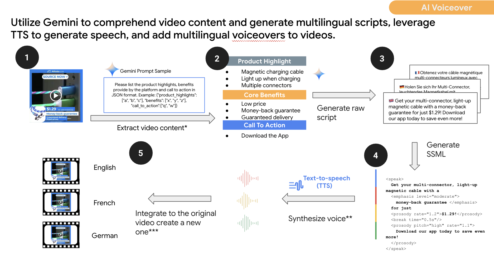

<!--
Copyright 2024 Google LLC

Licensed under the Apache License, Version 2.0 (the "License");
you may not use this file except in compliance with the License.
You may obtain a copy of the License at

      https://www.apache.org/licenses/LICENSE-2.0

Unless required by applicable law or agreed to in writing, software
distributed under the License is distributed on an "AS IS" BASIS,
WITHOUT WARRANTIES OR CONDITIONS OF ANY KIND, either express or implied.
See the License for the specific language governing permissions and
limitations under the License.
-->
# VideoMate - VoiceOver for Video Ads with Generative AI

[](https://github.com/google-marketing-solutions/videomate/commits)
[](https://github.com/google/gts)

## Disclaimer

Copyright Google LLC. Supported by Google LLC and/or its affiliate(s). This solution, including any related sample code or data, is made available on an “as is,” “as available,” and “with all faults” basis, solely for illustrative purposes, and without warranty or representation of any kind. This solution is experimental, unsupported and provided solely for your convenience. Your use of it is subject to your agreements with Google, as applicable, and may constitute a beta feature as defined under those agreements.  To the extent that you make any data available to Google in connection with your use of the solution, you represent and warrant that you have all necessary and appropriate rights, consents and permissions to permit Google to use and process that data.  By using any portion of this solution, you acknowledge, assume and accept all risks, known and unknown, associated with its usage and any processing of data by Google, including with respect to your deployment of any portion of this solution in your systems, or usage in connection with your business, if at all. With respect to the entrustment of personal information to Google, you will verify that the established system is sufficient by checking Google's privacy policy and other public information, and you agree that no further information will be provided by Google.


## Solution Introduction

This solution is to smartly generate voice overlay by understanding the video content and generating scripts using Gemini (Gemini 1.5 Pro), converting the Gemini generated scripts to natural-sounding speech using the Cloud Text-to-Speech API, and synthesizing the voiceover with the original videos into video creatives with better promising ads performance.

This solution is designed to address the challenges of those clients who have limited resources to produce human voice over for video creatives. The predicted impact is to uplift the conversion rate and the brand awareness of the video creatives. After adding the AI voice over, conversion rate will be uplifted by 9% in the Video For Action campaign. Brand awareness will be uplifted by 33% in the Branding campaign.


## Feature Highlights

This solution is designed with the following features:


### Basic Features


* Video content understanding
* Multilingual voice over script generation
* SSML generation
* Text-to-Speech convert
* Video synthesis with voice over
* Voice over scripts logging


### Advanced Features


* Prompt templatization for video understanding and voice over script generation
* Voice over substitution and optimization for videos with original dubbing
* [Planning] Multilingual Text-to-Speech convert in adaptation with video length (Dynamic speech length control)
* [Planning] Custom voice based on open source model (English and Chinese only)


## Workflow Execution Details and Steps


### High Level Workflow Design




### Data and Component Dependency

To combine internal data assets and external-friendly models, APIs and infrastructure, we leveraged:


* **Input Videos - **Users are to prepare the input videos to add voice over. Videos with or without original vocal dubbing are both supported. Input videos are supported to be uploaded to the conventional path and folder within Google Cloud Storage (GCS), by default in .mp4 extension, and specify the GCS bucket, folder and object name; or to be uploaded to YouTube and specify the URL.
* **[Gemini 1.5 Pro](https://cloud.google.com/vertex-ai/generative-ai/docs/model-garden/explore-models)** - Google's next-generation large language model, representing a significant step forward in AI capabilities. Using  Gemini 1.5 Pro to execute multiple tasks including: 1) Video content understanding, 2) Voice over script generation, 3) SSML generation.
* **[Cloud Text-to-Speech API](https://cloud.google.com/text-to-speech?hl=en#demo)** - A service that leverages advanced AI and machine learning models to convert written text into natural-sounding spoken audio. Using Cloud TTS API to convert the script/SSML into natural-sounding speech.
* **[FFmpeg](https://www.ffmpeg.org/)** - A powerful and versatile open-source multimedia framework. It's a collection of libraries and tools that can handle virtually any task related to audio, video, and other multimedia formats. Using FFmpeg to synthesize the voiceover with the original video with volume balancing and speed optimization.
* **[Cloud Function](https://cloud.google.com/functions?hl=en) or [Google Kubernetes Engine](https://cloud.google.com/kubernetes-engine?hl=en)** - as runtime environment for computing
* **[Cloud Pub/Sub](https://cloud.google.com/pubsub/docs/overview)** - as an asynchronous and scalable messaging service to dispatch video voice over tasks for parallel purpose
* **[BigQuery](https://cloud.google.com/bigquery?hl=en)** - as the log storage and analysis database
* **[Looker Studio](https://lookerstudio.google.com/overview)** - as the output visualization monitor


### Implementation Steps


#### Step 1 - Data Preparation


##### Input Template

It is recommended to use this [input template](https://docs.google.com/spreadsheets/d/1V9NMg7SH_xgu1JC4sgyDNJG8i7Yc3ovuNk9eczvd3lA) to handle the data preparation.

In this step, the input data is to be prepared for the following video voice over generation pipeline. Once the input metadata is provided, the value of the input videos and expected voice over parameters would be extracted in the following steps for corresponding operations by convention.

Please see the **Solution User Manual** section for the detailed explanation for the input fields in the input template.


##### Upload Input Videos to the Google Cloud Storage

Under the situation of adoption of Google Cloud Storage as video input, it is required that the videos are to be uploaded to the Google Cloud Storage corresponding bucket and folder, aligned with the  client_name, yyyymmdd, version that was specified in the input template. The by default path is: gs://{YOUR_BUCKET}/{YOUR_TOP_LEVEL_FOLDER}/{CLIENT_NAME}/{YYYYMMDD}/input/{VERSION}/{GCS_OBJECT_NAME}


#### Step 2 - Video Content Understanding

In this step, the Vertex AI multimodal model (Gemini 1.5 Pro) is leveraged to understand the video content, including visual elements, vocal elements, text elements, and content elements. The video understanding is one of the fundamental materials for the voice over script generation step.

There is some limitation of the video understanding procedure using Gemini multimodal capability -


* Videos with audio are limited to approximately 50 minutes;
* Videos without audio are limited to 1 hour;
* Individual video file size are limited to 2GB;
* Maximum number of videos per request: 10 videos;

It is also recommended not to reach the limit of the video length, size and number. Best practice is to limit the length of the total input videos within 2 minutes per request.

If the video length exceeds the recommended length, it is considered to shorten the duration by speeding up using FFmpeg in order to reduce video processing costs and increase the efficiency. Here is an example of doing so:

> \# shorten the duration by speeding up<br>
> ffmpeg -i "$input_file_path" -an -filter:v "setpts=0.5*PTS" -y "$output_file_path" -loglevel quiet
>
> \# Control video duration<br>
> ffmpeg -ss 00:00:00 -t 00:01:58 -i "$output_file_path" -c:v copy -y "$temp_file" -loglevel quiet
>
> \# Compress video file size<br>
> ffmpeg -i "$output_file_path" -c:v libx264 -profile:v high -crf 28 -s 480x854 -y "$temp_file" -loglevel quiet

#### Step 3 - Voice Over Script and SSML Generation


##### Voice Over Script Generation

In this step, the Vertex AI multimodal model (Gemini 1.5 Pro) is leveraged to generate the voice over scripts which synergize with the input video and the prompt instructions.

It is also supported to ingest some text prompts along with the video as input in this step, as is specified in the input spreadsheet, by the field “voiceover_script_context_prompt” as introduced above. Here is the flexibility of specifying narrative and emphasis of the final voiceover script by the customized prompts at video level.

Some common practices and recommendations for the prompt


* Specify narrative and emphasis of the voiceover script
* Instruction of not to use particular type of narration (eg. superlative modifiers)
* Ingestion of video level additional text information if there is any
* Requirement of adding call-to-action phrases at the end of the script
* For short videos, requirement of “Output in one sentence” to avoid the script to be too long


##### Voice Over Script Pre Check

This step is to pre-check the voice over script length across the video length. The principle is to retry script generation or fail over if the script generated by Gemini is too long, comparatively with the input video length.

It is recommended to use some particular length factors to pre-detect whether the scripts are too long. For example, in English, the best practice is to set the pre-check length factor as 11, and retry to call Gemini to re-generate the script if the size is larger than expected. Here is a sample code:

```python
max_retry = 5
count = 0
    while count <= max_retry and len(self.voice_over_script) >= self.video_length * 11:
    text_prompt = f'Please shorten the original voiceover script by dropping some of the detailed information. Please try to keep some attractive keywords related to the business context, and also maintain the call-to-action phrases if possible.\n Original voiceover script: {self.voice_over_script}.'
    self.voice_over_script = get_gemini_response(text_prompt, None, self.gemini_pro_model, parameters, safety_settings)
    count += 1
```

Please be noted, this script length checking factor could be different based on the language, since the syllables per second are different in different languages, the chart shown in this article illustrates [the syllable rate and information rate in selected languages](https://www.reddit.com/r/europe/comments/okvbpv/syllable_rate_and_information_rate_in_selected/).


##### [Optional] SSML Generation

Going forward, SSML script is to be generated by Gemini based on the understanding of the video content, as the most essential input in the following speech generation procedure. SSML stands for Speech Synthesis Markup Language. It is an XML-based markup language used to provide instructions on how text should be converted into speech by a text-to-speech (TTS) engine. The advantage of using SSML is to create a natural speech output and realize more sophisticated voice control.


#### Step 4 - Speech Generation and Synthesization


##### Speech Generation

In this step, the Cloud Text-to-Speech API is leveraged to convert the voice over script or SSML to audio. This is where the input language code, voice id and voice gender, together with the voice script generated by Gemini from the previous steps are needed as input of the TTS API.

Here is a code sample of [speech synthesis from a string of text](https://cloud.google.com/text-to-speech/docs/samples/tts-quickstart?hl=en#tts_quickstart-python).


##### Audio Check

This step is to hard check the generated audio length from the TTS API across the video length. The principle is to restrict the audio length to be larger than the video length beyond expectation.

Likewise, it is recommended to use some particular speeding factors to hard check whether the audios are too long. For example, in English, the best practice is to set the speeding factor as 1.2, and mark failure if the audio length is still larger than the video length after audio speeding up. Here is a sample code:

```python
audio_length = self._get_audio_length(audio_file_name)
speed_factor = max(1, audio_length / video_length)
if speed_factor > 1.2:
      os.remove(audio_file_name)
      err_msg = f'Speech length is longer than video length. {audio_length} > {video_length}, speed_factor:{speed_factor}'
      return False, err_msg
else:
      # proceed to the step of Synthesization of Audio and Video
      return True, err_msg
```

##### Synthesization of Audio and Video

We then use the FFmpeg, a powerful and versatile open-source multimedia framework, to synthesize the voiceover with the original video with volume balancing and speed optimization.

If it is specified by the field of “original_video_has_vocal_dubbing” in the input spreadsheet, an extra step is needed here for the human vocal cancellation. The vocal is removed from the original video by trying to eliminate or reduce the sound of the center channel. Here is an example of FFmpeg command:

> ffmpeg -i input.mp4 -af "pan=stereo|c0=c0-c1|c1=c0-c1" -c:v copy output.mp4

For the final video and audio synthesization, it is recommended to firstly operate the audio files normalization between the audio generated by the TTS API and the loudness of the original input video (after human vocal cancellation if necessary). The sample FFmpeg command below takes two input files and normalizes their loudness levels. Normalization ensures that both files have a consistent perceived loudness, which is particularly useful when you want to mix them together or compare them without jarring volume differences.

> ffmpeg-normalize<br>
>   {video_file_after_vocal_removal} {audio_file}<br>
>   -o {video_file_after_vocal_removal} {normalized_audio_file}

Last but not least, the synthesization of the normalized audio file  and the original video file. The following sample FFmpeg command replaces the audio in a video with a processed version of extracted vocals, while keeping the original video stream intact. It adjusts the loudness, delay, and tempo of the vocals, and mixes them with the background audio from the original video.

> ffmpeg<br>
>   -loglevel error<br>
>   -i {video_file} -i {video_file_after_vocal_removal} -i {normalized_audio_file}<br>
>   -filter_complex<br>
>   "[2:a] loudnorm=I=-13,adelay=delays={millisecond_start_audio}:all=1,atempo={speed_adjust} [voice_dub];<br>
>   [1:a] loudnorm=I=-19 [original_audio];<br>
>   [original_audio][voice_dub] amix=duration=longest [audio_out]"<br>
>   -c:v copy -c:a aac<br>
>   -map 0:v -map "[audio_out]"<br>
>   -y {generated_video_file}<br>


#### Step 5 - Output and Logging


##### Video Output

The final output will be uploaded back to the Google Cloud Storage bucket and folder path you specified in the input spreadsheet. By default the folder path of the output videos is: gs://{YOUR_BUCKET}/{YOUR_TOP_LEVEL_FOLDER/{CLIENT_NAME}/{YYYYMMDD}/output/{LANGUAGE_CODE}/{VERSION}/{GCS_OBJECT_NAME}__{VOICE_ID}_{VOICE_GENDER}_{LANGUAGE_CODE}.mp4


##### Intermediate Process Data

Two intermediate process data would be stored in the Google Cloud Storage folders as well.


* The downloaded video would be stored in the folder - gs://{YOUR_BUCKET}/{YOUR_TOP_LEVEL_FOLDER/{CLIENT_NAME}/{YYYYMMDD}/{VERSION}/downloads
* The audio files generated by the TTS API would be stored in the folder - gs://{YOUR_BUCKET}/{YOUR_TOP_LEVEL_FOLDER/{CLIENT_NAME}/{YYYYMMDD}/{VERSION}/audio


##### Logging

The logging would store the core information for each video which was specified in the input spreadsheet. These information includes:


* client_name
* yyyymmdd
* version
* voice_id
* video_id (gcs_object_name if GCS mode chosen)
* direct_script
* execution_status
* file_location
* err_msg

There are two versions of the logging storage based on the runtime environment you selected.


* For the Colab Pro as runtime, a new spreadsheet named {INPUT_SHEET}_RESULT would be created and the log would be automatically stored here.


* **[Only Supported in Customization Mode]** For the GCP (GKE or Cloud Function) as runtime, a BigQuery table would be created in advance and the log would be automatically inserted into the BigQuery logging table.


## Deployment Guidance

Please note that there are two modes offered - the Colab Pro Serial Mode and the GCP Hosted Batch Processing Mode.

For internal experiment and demo usage, we recommend the Colab Pro Serial Mode; the GCP Hosted Batch Processing Mode is only available by customized effort.


### Colab Pro Serial Mode


#### 1. Prerequisites & Google Cloud Platform(GCP) setup


##### 1.1 Create a GCP project with billing account

You may skip this step if you already have a GCP account with billing enabled.


* How to [Create a GCP Account](https://cloud.google.com/?authuser=1) (if you don't have one already!)
* How to [Create and Manage Projects](https://cloud.google.com/resource-manager/docs/creating-managing-projects)
* How to [Create, Modify, or Close Your Billing Account](https://cloud.google.com/billing/docs/how-to/manage-billing-account)


##### 1.2 Preparation for the Role and APIs

Keep in mind that the APIs, Models and infrastructure are to be used are:


* Model:
    * Vertex AI - Gemini 1.5 Pro
* API:
    * Cloud Text-to-Speech API
    * Google Sheets API
* Infra:
    * Google Cloud Storage


##### 1.3 Check the Roles and Permissions

Make sure the user running the installation has the following permissions.

[Editor Role in Google Cloud Project](https://www.google.com.hk/url?q=https://cloud.google.com/iam/docs/understanding-roles&sa=D&source=docs&ust=1701155826041582&usg=AOvVaw3EV65zZ6_iGIpGsittQC_X).


##### 1.4 Enable Required APIs

Go to [Vertex AI console](https://pantheon.corp.google.com/vertex-ai), Click **Enable All Recommended APIs** in the Vertex AI dashboard.

It might take a few moments for the enabling process to complete. A blue ring circling the bell icon appears in the upper right of the Google Cloud console as the APIs are being enabled.


#### 2. How to deploy our solution

2.1 Make a copy of this [colab](https://colab.sandbox.google.com/drive/1i5RE3bIAUaIXbwOYBv8M6SwX4VqHMHqY)


### GCP Hosted Batch Processing Mode


1. One dispatch service hosted in GKE
    1. Provide the UI that can apply the trix
    2. It will read each row of trix and send row to pubsub
2. Worker service hosted in GKE
    3. Will get information from pubsub and get video from gcs
    4. Autoscale by pubsub depth of queue
    5. Generated data to gcs and BigQuery


## Solution User Manual


### Colab Pro Serial Mode


#### Step 1 - Data Preparation


##### Input Template

It is recommended to use this [input template](https://docs.google.com/spreadsheets/d/1V9NMg7SH_xgu1JC4sgyDNJG8i7Yc3ovuNk9eczvd3lA) to handle the data preparation.

In this step, the input data is to be prepared for the following video voice over generation pipeline. Once the input metadata is provided, the value of the input videos and expected voice over parameters would be extracted in the following steps for corresponding operations by convention.

Explanation for the input fields in the input template:

**client_name**

Please log your client name here for: 1) One of the fields for voice over progress tracking; 2) One of the components of the Google Cloud Storage object folder path (if you put your videos in the Google Cloud Storage)

**yyyymmdd**

Please log the timestamp in the format of yyyymmdd for: 1) One of the fields for voice over progress tracking; 2) One of the components of the Google Cloud Storage object folder path (if you put your videos in the Google Cloud Storage)

**version**

Please log a version id in the format of string for: 1) One of the fields for voice over progress tracking; 2) One of the components of the Google Cloud Storage object folder path (if you put your videos in the Google Cloud Storage); 3) In some use case, one practice is to use the version field as an unique id of marking the individual video.

**gcs_object_name**

Support and recommend to use the Google Cloud Storage as video input. Please follow the folder path and protocol using the above input fields - client_name, yyyymmdd, version. The by default GCS bucket, folder and object name is: gs://{YOUR_BUCKET}/{YOUR_TOP_LEVEL_FOLDER}/{CLIENT_NAME}/{YYYYMMDD}/{VERSION}/input/{GCS_OBJECT_NAME}

**yt_link**

[Deprecated] Support but do not recommend using the YouTube Video link as the video input. Considering the YouTube download is not stable enough, it is recommended to use the Google Cloud Storage as video input.

**language_code:**

Describe the language of the voice over. If you'd like to provide language code, see full list here in the "language code" column:[ https://cloud.google.com/text-to-speech/docs/voices](https://cloud.google.com/text-to-speech/docs/voices)

**voice_id and voice_gender:**

Describe the voice type of the voice over. If you'd like to provide a voice name, see the full list here in the "voice name" column:[ https://cloud.google.com/text-to-speech/docs/voices.](https://cloud.google.com/text-to-speech/docs/voices.) You can click on the Play button and listen to the sample to make sure which voice type you prefer.

**voiceover_script_context_prompt:**

Please write the core prompt for voiceover script generation. Here provides the flexibility of specifying the narrative and emphasis of the final voiceover script by the customized prompts at video level.

**[Optional] original_video_has_vocal_dubbing:**

This is an extension feature to replace the original voice over with our AI generated voice over. If the input video already has voice over and it is intended to remove it, please mark YES in this column.


##### Upload Input Videos to the Google Cloud Storage

Under the situation of adoption of Google Cloud Storage as video input, it is required that the videos are to be uploaded to the Google Cloud Storage corresponding bucket and folder, aligned with the  client_name, yyyymmdd, version that was specified in the input template. The by default path is: gs://{YOUR_BUCKET}/{YOUR_TOP_LEVEL_FOLDER}/{CLIENT_NAME}/{YYYYMMDD}/input/{VERSION}/{GCS_OBJECT_NAME}


#### Step 2 - Execute the Colab

Please make a copy of this [colab](https://colab.sandbox.google.com/drive/1i5RE3bIAUaIXbwOYBv8M6SwX4VqHMHqY) and execute the nodes step by step.


##### Configuration

Please be noted that some variables such as GCP_PROJECT_ID, GCS_BUCKET, TOP_LEVEL_FOLDER, INPUT_TRIX_ID, INPUT_SHEET_NAME, it is the responsibility of users to substitute the corresponding configuration info.


##### Serial Manner

During the Colab execution, all data in the input spreadsheet would be pulled and executed in the video voice over generation pipeline in a serial manner.


#### Step 3 - Log Stored back to Input Sheet

Please keep observation at the result sheet - by default in a new spreadsheet named {INPUT_SHEET}_RESULT. For each video that has been handled successfully or not, a log would be added to the result sheet. The log includes:


* client_name
* yyyymmdd
* version
* voice_id
* video_id (gcs_object_name if GCS mode chosen)
* direct_script
* execution_status
* file_location
* err_msg


#### Step 4 - Error Analysis and Retry


##### Error Analysis

The error reasons could be:


* Gemini Script Generation Error: When Gemini reads the video, the video might include some sensitive images or other information that exceeds the safety setting of the Gemini 1.5 Pro mode. In some cases, multiple retries could resolve this issue. It is suggested trying to contact the Cloud team to introduce your business and use case, and to request to add your GCP project into the allowlist.
* Audio Length Check Error: As introduced above, in the audio length hard check procedure, if the speeding factor is larger than the conventional maximum speeding factor (for English, 1.2), it is considered a failure request in the log.
* Write Spreadsheet Error: It is observed that such errors might happen from time to time due to network or Sheets API quota. Please kindly retry to execute the current node in the Colab.

Except the Write Spreadsheet Error, all other errors/exceptions are not expected to block the progress of the executions for the subsequent videos voice over generation. If any errors are observed that blocks the voice over generation progress for the remaining videos to be handled, please kindly let us know.


##### Runtime, Disconnect and Resume

Please also be aware that, if the Colab runtime is disconnected or manually closed, it is supported to trigger a rerun manually, and it will continue the execution from the videos that have not been processed. It will not start over from the very beginning and override all existing successful results.


##### Retry

Once it is observed that all videos have been executed in the result sheet, either success or fail. It is the time to trigger a rerun in the Colab if the success rate (success results / all results) is less than expected. Only videos that were not successful in the previous round would be triggered and executed again in this case.


#### Step 5 - Video Output

The final output will be uploaded back to the Google Cloud Storage bucket and folder path you specified in the input spreadsheet. By default the folder path of the output videos is: gs://{YOUR_BUCKET}/{YOUR_TOP_LEVEL_FOLDER/{CLIENT_NAME}/{YYYYMMDD}/output/{LANGUAGE_CODE}/{VERSION}/{GCS_OBJECT_NAME}__{VOICE_ID}_{VOICE_GENDER}_{LANGUAGE_CODE}.mp4


### GCP Hosted Batch Processing Mode

#### Step 1 - Data Preparation

This step is exactly the same as the **Step 1 - Data Preparation** above.

After the creation of the input template using Google Sheet, please grant editor access to the Service Account of the GCP. The Service Account could be found in the Details Tab of the Kubernetes Engine or Cloud Function.


#### Step 2 - UI for Manually Trigger the Batch Processing

Once the input is specified in the Step 1 Input spreadsheet in Google Sheet, an UI is provided for users to fill in the input parameters, and click on the “Run” button to manually trigger the workflow to run once.

The input parameters includes:

* [Optional] GCP Project ID (by default the client’s GCP project)
* [Optional] GCP VERTEX AI REGION (by default)
* Google Cloud Storage Bucket Name
* Google Cloud Storage Top Level Folder Name
* Google Sheet ID of the input sheet (eg. 1ToNT1SGny9DZJVPJMMWPUUvUy0BxljnRHrFZXIDZy5Q)
* [Optional] client_name
* **yyyymmdd**
* version

The parameters of client_name, yyyymmdd, version mark a batch of trigger and run. Once you click “Run” on the UI, all videos in the input sheet with the selected client_name, yyyymmdd, version would be pulled and pushed into a queue, downstream working nodes would be prepared and handle single video voice over logic in a parallel manner.

Please also be noted, if the “Run” button is clicked for the same batch (same client_name, yyyymmdd, version), it is essentially a retry operation, which means only failure videos in previous rounds would be pulled and triggered.


#### Step 3 - Log Stored in BigQuery table

A BigQuery table will be created beforehand, to store all video voice over execution status, and to log essential information, including:

* Google Sheet ID
* client_name
* yyyymmdd
* version
* voice_id
* gcs_object_name ( if GCS mode chosen)
* direct_script
* execution_status
* file_location
* err_msg

Considering the purpose and need of retry for each batch execution, this BigQuery table is also used to check and filter out already successful video tasks and only select those videos which previously failed to be pulled and retried.


#### Step 4 - Monitor the Progress in Looker Studio Dashboard

For the visualization and batch processing tasks monitor purpose, a dashboard within Looker Studio would be created to provide the fundamental metrics and detailed execution results for each batch. The underlying table of this dashboard would be the BigQuery table created and logged in the previous step.

For offline data analysis, Google Sheets with final results could be exported from the detailed table within the  Looker Studio Dashboard.


#### Step 5 - Video Output

The final output will be uploaded back to the Google Cloud Storage bucket and folder path you specified in the input spreadsheet. By default the folder path of the output videos is: gs://{YOUR_BUCKET}/{YOUR_TOP_LEVEL_FOLDER/{CLIENT_NAME}/{YYYYMMDD}/output/{LANGUAGE_CODE}/{VERSION}/{GCS_OBJECT_NAME}__{VOICE_ID}_{VOICE_GENDER}_{LANGUAGE_CODE}.mp4


## Throughput


### Colab Pro Serial Mode

Resource Specifications: Colab Pro - 100 compute units

Throughput: 60 videos / hr


### GCP Hosted Batch Processing Mode

Resource Specifications: GKE & BigQuery

Throughput: 60 - 1000 /hr depending on how much resource we use


## Cost Estimation

**Assumption**


* The original video is 90 seconds and the edited video is 15 seconds.

**Video Understanding **


* Gemini 1.5 Pro: 105 seconds of video, about $0.17

**Speech Generation **


* Cloud Text-to-Speech API: single audio track generation, about 1000 bytes, $0.016 (The first 1 million bytes are free)

**Synthesis of Audio and Video**


* Single video synthesis, about 60 seconds, $0.0002 (2C2G) - Synchronous function call mechanism is used (no retry is required for a single successful function call), batch asynchronous calls may be cheaper

**Other Infrastructure**


* Google Cloud Storage:   $0.023 per GB, single video (10MB) cost 0.00023 per month
* Pub/Sub ：$40 per TiB，The first 10 GiB is free each month.
* BigQuery : $0.02 per GiB per month , The first 10 GiB is free each month.
* Looker Studio : free for personal use

**Total Cost**


* For one single video: 0.17+0.016+0.0002 = $0.18


## Contact Us

Email:

[sicongchen@google.com](mailto:sicongchen@google.com)

[dongshic@google.com](mailto:dongshic@google.com)